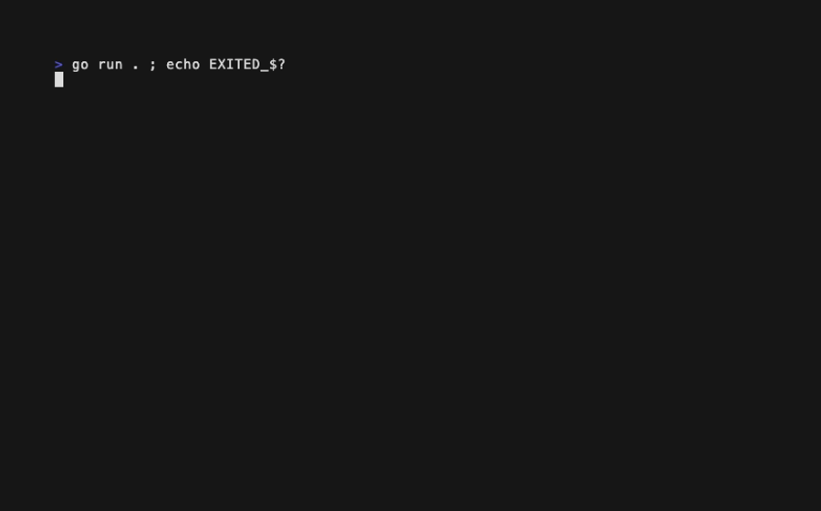
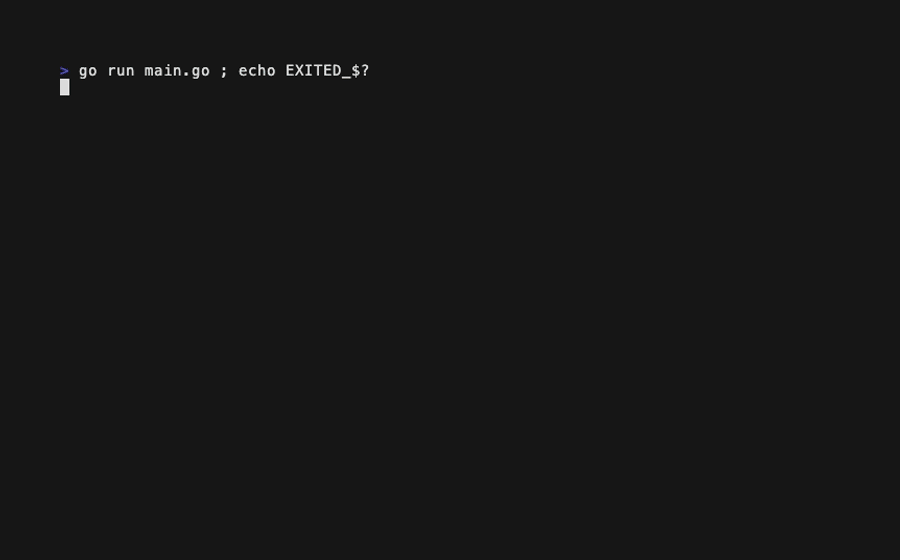

# Kimi-Linear-48B-A3B — hello-go-bubbletea

Results for locally hosted model `Kimi-Linear-48B-A3B` on the `hello-go-bubbletea` test.

> Create a fun, creative "Hello, World!" application in Go using
> `charmbracelet/bubbletea`, with everything needed to build and run it; the
> only strict requirement is that pressing `q` must always quit the program.

| Run | Builds | Runs | Meets requirements | Score | Notes |
|-----|--------|------|--------------------|-------|-------|
| 1   | ✅     | ✅   | ✅                 | 8/10  | Menu app; `q` quits, but no animation, no color, and two dead-end screens |
| 2   | ⚠️     | ✅   | ✅                 | 7/10  | `go build` fails (two `main` functions); `go run main.go` works; animation never starts |
| 3   | ❌     | ❌   | ❌                 | 0/10  | Does not compile: hallucinated `tea.KeyQ`, `tea.KeyArrowUp`, undefined `PausedState` |
| 4   | ❌     | ❌   | ❌                 | 0/10  | Does not compile: types declared twice, hallucinated `time.TickMsg`, no `Init` method |

**Average score: 3.8/10**

## Run 1



A five-item menu ("Play Game", "Show Colors", "Input Mode", "High Score",
"Quit") under a "Hello Go Bubbletea World!" title, delivered with a README,
Makefile, `.gitignore`, and two shell scripts. It builds cleanly with
`go build` and `q` quits from every screen. Almost nothing else works as
described. `Init` returns `nil` and no tick command is ever issued, so the
"color-cycling" title, the particle system, and the game never animate, and
the particles are never drawn at all. Every color is given by name
(`lipgloss.Color("red")`), which lipgloss does not recognize, so the whole UI
renders in the default foreground. The Color Demo says "Press ESC to return"
but ESC does nothing there, the High Score screen says "Press any key to
continue" and no key leaves it, the game screen has no exit either, and Input
Mode cannot accept typed text. The "persistent" high score is an `os.Setenv`
call that dies with the process.

Score: 3 + 2 + 3 + 0 = 8/10

## Run 2



A three-phase "particle symphony" in `main.go`, plus a `demo.go` that only
prints a description of the program. Both files declare `main` in the same
package, so the package build that the model's own README offers fails:

```
./main.go:265:6: main redeclared in this block
	./demo.go:7:6: other declaration of main
```

The README's other instruction, `go run main.go`, does work, so this run is
scored as building with a workaround (2) and the GIF was recorded that way.
The program starts and `q` quits. The animation never begins: `Update` handles
a `time.Time` tick, but `Init` returns only `tea.EnterAltScreen` and nothing
ever schedules the first tick, so the screen stays on phase 0 and the
particles and phase transitions are unreachable. `main` also shells out to
`go list` and `go get` at startup to "install bubbletea", which is pointless
in a compiled binary. The text "Hello, World!" never appears on screen; the
program shows "Welcome to Bubbletea!" instead.

Score: 2 + 2 + 3 + 0 = 7/10

## Run 3

The most ambitious design of the four: an arrow-key game with menu, playing,
paused, game-over and win states, particle bursts, a Makefile, and a
`main_test.go`. It does not compile. The model invented key constants that
Bubble Tea does not have, used a state it never declared, and called a
`Render` method on `lipgloss.Color`:

```
./main.go:109:12: undefined: tea.KeyQ
./main.go:118:15: cannot use m.updateParticles (value of type func() ([]particle, tea.Cmd)) as tea.Cmd value in return statement
./main.go:120:15: undefined: PausedState
./main.go:127:12: undefined: tea.KeyArrowUp
./main.go:284:21: p.color.Render undefined (type lipgloss.Color has no field or method Render)
./main.go:299:53: invalid operation: centerX + offset (mismatched types int and float64)
./main.go:299:53: too many errors
```

The `q` handler itself is one of the lines that fails (`tea.KeyQ`). The
tests cannot run for the same reason. No GIF was recorded.

Score: 0 + 0 + 0 + 0 = 0/10

## Run 4

A color-animated "Hello, World!" with particles and sparkles, wrapped in the
most paperwork of any run: README, `PROJECT_SUMMARY.md`, Makefile, `demo.sh`,
`test.sh`, and a `simple-main.go` "fallback version without bubbletea
dependencies". As delivered, `go.sum` lacked the entries needed to build;
after `go mod tidy` the code still does not compile. `main.go` declares
`Model`, `particle`, and `sparkle` twice, has no `Init` method, and matches on
a `time.TickMsg` type that does not exist:

```
./main.go:47:6: Model redeclared in this block
./main.go:59:6: particle redeclared in this block
./main.go:69:6: sparkle redeclared in this block
./main.go:159:11: cannot use m (variable of struct type Model) as tea.Model value in return statement: Model does not implement tea.Model (missing method Init)
./main.go:172:12: undefined: time.TickMsg
./simple-main.go:9:6: main redeclared in this block
```

Building `main.go` on its own fails with the same errors. The only thing in
the directory that runs is `simple-main.go`, which uses no Bubble Tea and
prints a description of the application the model did not finish;
`PROJECT_SUMMARY.md` nonetheless reports every requirement as met. No GIF was
recorded.

Score: 0 + 0 + 0 + 0 = 0/10
